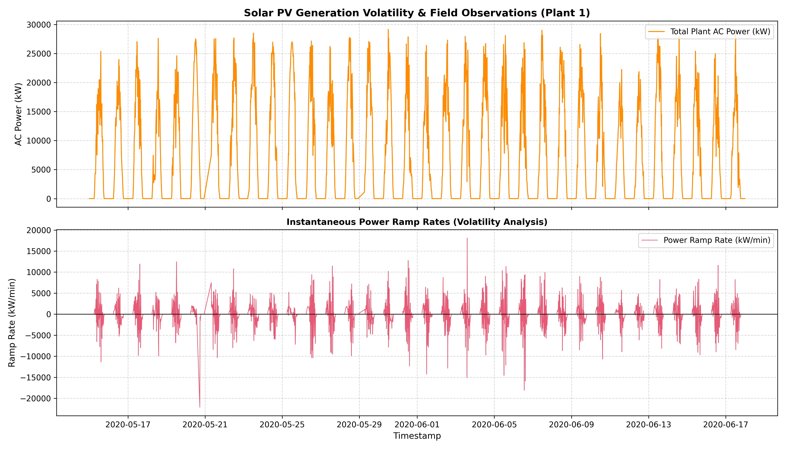

# PV Generation Volatility Analysis

## Overview
This repository provides an end-to-end Python pipeline for analyzing high-frequency solar photovoltaic (PV) generation volatility and power ramp rates using real-world SCADA telemetry data.

## Key Objectives
- **Field Data Preprocessing:** Clean, structure, and aggregate multi-inverter time-series data.
- **Ramp Rate Characterization:** Quantify instantaneous power fluctuations (sudden drops and surges caused by atmospheric variations and cloud cover).
- **Volatility Visualization:** Produce publication-ready diagnostic charts highlighting solar generation dynamics.

## Visual Results

## Tech Stack
- **Language:** Python
- **Libraries:** Pandas, NumPy, Matplotlib
- **Environment:** Google Colab
